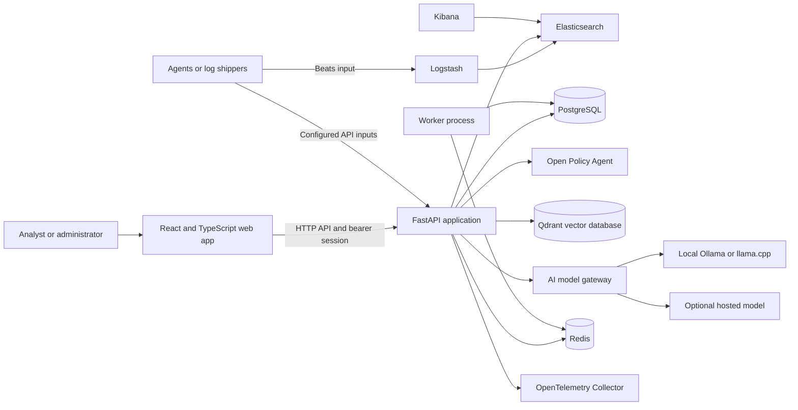

# NEURAL DETECT: Beginner Architecture and Workflow Guide

This guide explains how NEURAL DETECT works, where its parts live, and what the GitHub Actions workflows do. It is intended for someone new to the repository. Detailed interfaces and design choices are linked at the end.

## 1. What this application is

NEURAL DETECT is a local-first security operations and detection-engineering platform. It provides a browser interface for security telemetry, detection rules, threat intelligence, AI-assisted hunting and investigations, model settings, and AI security evaluations.

It is a **modular monolith**: the main application is one FastAPI service, organized into modules, with separate data stores and supporting services around it. “Local-first” means local data storage and local model inference are the default; hosted AI is optional and guarded by policy and consent.

## 2. Big-picture map



Docker Compose creates a private network. Services call each other by service name; for example, the API connects to PostgreSQL at `postgres`. This diagram shows intended connections. The worker implementation is currently a heartbeat placeholder: it logs that queue handlers are not configured and sleeps. Redis and a worker container existing does not mean background jobs are being consumed.

## 3. Services in plain language

The services are declared in the root `docker-compose.yml`.

| Service | What it does |
|---|---|
| `frontend` | React/TypeScript browser pages for overview, detections, models, agents, intelligence, and administration |
| `api` | FastAPI endpoints, authentication, authorization, application rules, database access, and integrations |
| `postgres` | Durable application records: tenants, users, audit events, detections and versions, approvals, and evaluation metadata |
| `elasticsearch` | Stores and searches security telemetry; the API queries it for dashboards and detections |
| `kibana` | Elastic web console; configured detection deployments target its security engine |
| `logstash` | Receives Beats events on port 5044 and forwards them to Elasticsearch |
| `redis` | Included for queues/short-lived data; current worker does not consume a queue |
| `worker` | Separate process for long-running work; currently logs a placeholder heartbeat only |
| `qdrant` | Vector store used for similarity search over indexed intelligence |
| `opa` | Open Policy Agent evaluates role, tenant, and action authorization rules in Rego |
| `otel-collector` | Receives OpenTelemetry data on ports 4317/4318 |
| `ollama-relay` | Lets a container reach Ollama running natively in WSL |
| `ollama` | Optional container Ollama service, enabled with the `local-ai` Compose profile; it downloads no models automatically |

PostgreSQL, Elasticsearch, and Qdrant have different purposes. PostgreSQL stores application records and relationships. Elasticsearch stores event-shaped telemetry for search. Qdrant stores vectors for similarity search.

The base Compose setup is for local development and one host. Its Elasticsearch has security disabled. `infrastructure/docker-compose.prod.yml` is a stricter production-style overlay that expects secure settings; it is not a complete high-availability deployment.

## 4. How the application works

### Sign-in and permissions

1. The browser checks for a saved bearer session; without one it shows the login page.
2. `POST /api/v1/auth/login` checks the password hash and whether the user and tenant are active.
3. The API records an audit event and returns a signed, expiring token.
4. The browser attaches that token to later requests.
5. API middleware identifies the user and asks OPA whether that user may take the requested action for the tenant/resource.
6. Requests that do not satisfy policy are denied.

Authentication answers “who is this?” Authorization answers “may they do this here?” Roles include admin, security engineer, analyst, approver, and auditor. The rules are in `core/policy_engine/neural_detect.rego`.

### Telemetry and overview

Collectors send events through a configured API input or the Beats input on Logstash. Logstash forwards events to Elasticsearch. The authenticated browser then calls dashboard/telemetry API routes; FastAPI queries Elasticsearch and returns summary counts, source state, and alerts. The UI may be healthy but show no events when nothing has been indexed. An API health response alone does not prove data collection works.

### Detection-as-code

1. An authorized user submits Sigma YAML or a supported native query through the UI/API.
2. `detection_engine/` validates the source; Sigma is compiled using pySigma and its Elasticsearch backend.
3. PostgreSQL stores source, compiled query/deployment data, metadata, and a version snapshot.
4. A fixture test creates a temporary Elasticsearch index, inserts positive and negative sample events, runs the rule, reports expected matches, then removes the index.
5. Deployment is fail-closed: the rule version needs an approved, unexpired approval before the API sends it to Kibana.
6. Version history and approval decisions remain in PostgreSQL.

Compilation proves translation succeeded. Fixture testing proves behavior only for those sample events. Neither guarantees that production telemetry has the expected fields or data.

### AI model requests

1. The browser sends a typed request to FastAPI.
2. The model gateway checks provider and tenant policy, and any required consent.
3. It bounds request size and redacts sensitive values.
4. A provider adapter calls local Ollama/llama.cpp by default, or an explicitly configured hosted provider.
5. The gateway applies timeout/retry rules and validates structured output.
6. Safe metadata (provider, model, latency, usage, validation status) may be stored. Prompts and completions are intentionally not stored in model evaluation records.

Adapters are under `ai_engine/model_gateway/providers/`. Routing, policy, redaction, and response validation are next to them. A configured endpoint does not mean a model has been downloaded or loaded.

### Threat intelligence and AI security assurance

Threat-intelligence routes ingest and query ATT&CK/STIX content. Searchable records use PostgreSQL/Elasticsearch and embeddings use Qdrant. The browser talks to the API rather than directly to these databases.

AI Security Assurance runs repeatable control evaluations and synthetic adversarial prompt checks. Results are evaluation records, not a certification that a deployment is secure.

### Background work: current limitation

`apps/worker/worker.py` currently starts, logs that queue handlers are not configured, then sleeps. Job/status records exist, but this process is not yet a general-purpose queue consumer. Treat background execution as unfinished until queue handling, retries, and live integration tests are implemented.

## 5. Where code lives

| Directory | Contents |
|---|---|
| `apps/frontend/` | Browser UI, API client, login, and feature pages |
| `apps/api/` | FastAPI entry point and API routes |
| `apps/worker/` | Separate worker process; currently placeholder behavior |
| `core/authentication/` | Password hashing and session token helpers |
| `core/authorization/`, `core/policy_engine/` | API authorization and OPA/Rego policy |
| `core/database/` | SQLAlchemy models, connection setup, and Alembic migrations |
| `ai_engine/model_gateway/` | Model routing, privacy policy, provider adapters, and output checks |
| `ai_engine/detection_agent/`, `ai_engine/soc_agents/` | AI detection engineering, hunting, and investigations |
| `ai_security/` | Prompt/tool/RAG security checks and assurance evaluations |
| `detection_engine/` | Rule validation, Sigma compilation, native formats, fixture testing |
| `detection_rules/` | Starter rules and positive/negative fixtures |
| `integrations/` | Elasticsearch, ATT&CK/STIX, and SOAR integrations |
| `scripts/` | Setup, seeding, detection validation, and benchmark utilities |
| `tests/` | Automated Python tests |
| `infrastructure/` | Production Compose overlay and Logstash/OPA/telemetry configuration |
| `docs/architecture/` | Detailed system, data-flow, schema, API, security, agent docs and decision records |
| `.github/workflows/` | CI and container release workflows |

Database schema changes belong in Alembic files under `core/database/migrations/versions/`. Make a reviewed migration rather than treating a hand-edited live database as the permanent fix.

## 6. GitHub Actions workflows

GitHub Actions runs jobs on GitHub-hosted machines. Editing workflow files locally does not start a job. Here CI is configured for pushes, pull requests, and manual `workflow_dispatch`. The release workflow runs when a GitHub Release is published.

### CI: `.github/workflows/ci.yml`

The `quality` job runs in this order:

1. **Checkout**: obtains the commit being checked.
2. **Set up Python 3.12**: selects the runtime and enables pip caching.
3. **Install Python packages**: installs the resolved lock and the project/development tools.
4. **Ruff**: checks Python style and common errors.
5. **pytest**: runs automated Python tests.
6. **Detection validation**: validates/compiles bundled rules and fixture expectations.
7. **pip-audit**: checks locked Python dependencies against known advisories. This is intentionally blocking.
8. **Set up Node and npm cache**: selects Node 22.13.1 for the UI.
9. **npm ci**: installs exact versions from the lockfile.
10. **npm audit**: checks frontend packages for high-severity advisories.
11. **Frontend build**: type-checks and creates production assets.
12. **Compose checks**: validates the development and production-overlay configurations.

The job stops at a failing step. Later steps marked skipped are not extra errors: they were not reached.

### Release: `.github/workflows/release.yml`

This workflow runs only after a GitHub Release is published:

1. Requires `LICENSE` and `CHANGELOG.md`.
2. Builds and pushes API and production frontend images to GHCR.
3. Adds software bill of materials (SBOM) and build provenance.
4. Scans both images with Trivy for critical/high OS and library vulnerabilities.
5. Fails the publish job if the blocking scan finds a vulnerability.

Publishing a release pushes images. Do not publish a release merely to test CI.

## 7. First CI failure from the supplied screenshot

The screenshot shows commit `8a89295` on `main`. Ruff, pytest, and detection validation passed. The first failing command is:

```text
pip-audit --strict -r requirements.lock
Found 2 known vulnerabilities in 1 package
diskcache 5.6.3  PYSEC-2026-2447
Error: Process completed with exit code 1.
```

The two displayed rows name the same package and advisory. A read-only check on 2026-11-03 found 11 remote branches: main plus 10 Dependabot branches (five GitHub Actions updates and five frontend package updates). All ten open Dependabot PRs have a failed quality check, and each PR's failed step is pip-audit --strict -r requirements.lock. Because the job stops at that step, this does not tell us whether a branch would have additional failures later.

The dependency path is confirmed from the project image: requirements.lock pins diskcache==5.6.3; pySigma==1.5.1 requires diskcache>=5.6.3,<6; and pySigma-backend-elasticsearch==2.1.1 requires pySigma>=1.4,<2.0. The current [GitHub advisory](https://github.com/advisories/GHSA-w8v5-vhqr-4h9v) lists no patched DiskCache version, and [PyPI](https://pypi.org/project/diskcache/) currently lists 5.6.3 as its latest release. This means a lock-only version bump is not currently an evidenced fix. A compatible upstream upgrade or a tested replacement for the affected Sigma dependency path must be evaluated. Keep pip-audit blocking; do not hide or weaken the scan to make CI green.

## 8. Local development and careful debugging

Run Linux and Docker commands from WSL in this project:

```bash
cd /home/ghost/neural-detect
docker compose ps
```

These are local checks; they do not push a commit or start GitHub Actions:

```bash
ruff check apps ai_engine ai_security core detection_engine integrations scripts tests
pytest -q
python -m scripts.validate_detections
docker compose config --quiet
docker compose -f docker-compose.yml -f infrastructure/docker-compose.prod.yml config --quiet
```

To conserve GitHub Actions minutes, do not push debugging commits, open/update a pull request, use the Actions “Run workflow” button, or publish a release until a remote run is worth the cost. Inspect the exact failing job, reproduce locally when practical, fix one cause at a time, and record results. `scripts/setup.sh` can create a local ignored `.env`, start services, apply migrations, configure Elasticsearch, and seed rules; use it only when you intend to modify local services/data.

## 9. Glossary

- **API**: endpoints that the browser or tools call.
- **CI**: automated checks against a commit.
- **Compose service/container**: a named stack component / its running instance.
- **Detection rule**: a query that searches telemetry for a suspicious pattern.
- **Fixture**: a small sample event used to test expected rule behavior.
- **Migration**: a repeatable, versioned database schema change.
- **OPA/Rego**: authorization policy engine and its language.
- **SBOM**: a machine-readable inventory of packages in a build.
- **Tenant**: a logical organization boundary for users/data.
- **Workflow**: either an application data flow or an automated GitHub job; this guide states which one.

## 10. Detailed references

- [System architecture](architecture/SYSTEM_ARCHITECTURE.md)
- [Data flow](architecture/DATA_FLOW.md)
- [Database schema](architecture/DATABASE_SCHEMA.md)
- [API specification](architecture/API_SPECIFICATION.md)
- [Security architecture](architecture/SECURITY_ARCHITECTURE.md)
- [Agent architecture](architecture/AGENT_ARCHITECTURE.md)
- [Detection engine](../detection_engine/README.md)
- [Model gateway](../ai_engine/model_gateway/README.md)
- [Quick start](../QUICKSTART.md)
- [CI workflow](../.github/workflows/ci.yml)
- [Release workflow](../.github/workflows/release.yml)

